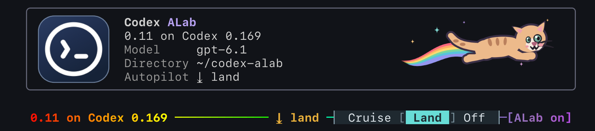

<!--
Copyright 2026 Andrew Yates
SPDX-License-Identifier: Apache-2.0
-->
# codex-alab

codex-alab is ALab's edition of OpenAI's [Codex CLI](https://github.com/openai/codex): the
same `codex`, built from OpenAI's open-source code with the Trust toolchain, merged with
upstream's `main` at least daily, and carrying a thin layer of ALab changes on top.

**Unofficial.** codex-alab is not made by, affiliated with, or endorsed by OpenAI. Codex is
OpenAI's product; report a codex-alab problem here, not to OpenAI. For OpenAI's own build, see
[openai/codex](https://github.com/openai/codex).

<a href="alab/design/codex-opening-banner.md#preview">
  <picture>
    <source media="(prefers-color-scheme: light)" srcset="alab/design/assets/codex-opening-banner-69-light.png">
    
  </picture>
</a>

## A drop-in `codex`

- The binary is `codex`, with upstream's subcommands and flags. You sign in with your own
  ChatGPT account or API key, and it talks to OpenAI's service as `codex` does.
- It reads and writes the same `~/.codex` (or `$CODEX_HOME`): `config.toml`, `auth.json`,
  sessions, logs. `codex exec`, `codex app-server` and MCP server configuration work
  unchanged, and so do the TypeScript and Python SDKs (`sdk/`), which drive codex through
  `exec --experimental-json` and `app-server`.
- Every ALab choice is a packaged default, the lowest config layer: your `config.toml`, a
  profile, a project config or `-c` wins over each one.

The 0.170.0 candidate passed all 18 comparisons with OpenAI's released binary,
covering 77 help pages, exec events, app-server schemas, configuration, MCP and
login. The two additional CLI commands expose ALab's packaged defaults and aterm
model policy. [Comparison results and release status](alab/reviews/openai-0.170-alignment-plan-2026-11-18.md)

## Resume after switching accounts

On signed ALab 0.11.0 in aterm, open `/accounts` to find the slot labels.
To move an idle conversation, close the pane and enter **`/accounts use <label>`**.
After the restart, `/status` shows the connected email and conversation ID.
For a session that already exited, use **`codex --no-daemon resume <thread-id>`**
with the selected login. The exit summary gives the ID. If you lost it,
`codex --no-daemon migrate-rollouts --verbose` lists local session IDs in a dry
run. The resume guide also shows how to find a session by preview and project.
[Account guide and full-address lookup](alab/interface.md#sign-in-and-separate-accounts)

On the reviewed 0.170 build, sign in with the account you want to use and run
**`codex resume`**. The enhanced picker shows active conversations from every
login and project sharing the same local Codex home, including work started by
`codex exec`. Select the conversation. If prompted, choose **Use session
directory** to run tools in its original project. If you moved the project,
start the picker in its new directory. The updated local picker highlights
**Use current directory** when the saved path is gone.
If the original app still has the conversation open, close it there and
press **R** in the same resume picker.
The next turn uses the currently signed-in account.
[Resume guide](alab/README.md#resuming-local-work-after-switching-accounts)

## Which OpenAI Codex it is built from

The ALab release and the Codex base have independent version numbers. A marked
release branch records the official OpenAI tag and its exact commit. A package built
from the development history records the newest OpenAI Codex stable release whose
branch point it includes and the exact upstream commit. A package built from a
published source snapshot can recover its Codex release from the ALab version ledger.
The snapshot alone does not identify the exact upstream commit.

- **In an enhanced session**, the launch card, composer and `/status` show the ALab release
  followed by its Codex base, for example `0.11 on Codex 0.169`. A nonzero patch stays
  visible, as in `0.169.1`. Click the release pair in the composer or use `/alab version`
  (also `/alab update`) to see the full running and installed package versions, update state
  and available source commits.
  `codex --version` prints the full `codex-cli <version>`.
- **In the package**, `alab-build.json` records the available provenance. For example,
  managed build `2026111701` contains these fields.

  ```json
  {
    "version": "0.11.0",
    "baseline": "0.169.0",
    "upstream": {
      "release": "rust-v0.169.0",
      "commits_since_release": 43,
      "commit": "ce3031018ef130e653ed4d9c5bb971652de97161",
      "commit_date": "2026-11-12T15:35:27Z"
    }
  }
  ```

  A snapshot-built package with a ledger baseline records `baseline` and omits
  `upstream` when it lacks upstream history. Older packages can also omit individual
  fields. Use `aterm pkg which codex` to locate the installed package.
- **On the release pages:** `alab/package.sh --upstream-base [--commit <rev>]` prints the
  line that names it, `Based on upstream openai/codex rust-v0.163.0 + 241 commits
  (e8aa7c1678ca, 2026-10-20)`. A source release's GitHub page carries that line for its
  source commit (`publish/release-body`, which the publication engine runs when it creates
  the release), and a package release's page (`atpkg-codex-<build>`) the same line read off
  the package's `alab-build.json`, without the count for a package that records none. The
  releases published before the pages named it (`v0.164.0`, `atpkg-codex-2026102001`) name
  none, and a published page is never rewritten ([`alab/README.md`](alab/README.md),
  "Publication").

## What ALab changes

Defaults ([`codex-rs/alab-core/defaults.toml`](codex-rs/alab-core/defaults.toml)) turn off:

- the update check (it polls GitHub and Homebrew every 20 hours; a codex-alab install moves
  to a new package, never to OpenAI's build);
- product analytics, Statsig metrics and `/feedback` uploads to OpenAI's Sentry;
- the shared app-server daemon (1.5 GB of package copies, a process that never exits, and
  OpenAI's own updater): each TUI embeds its app-server;
- ChatGPT apps and the plugin marketplace (a sync at every start and about 142 MB of caches),
  the skill-search shadow experiment, the image tool and tool-install suggestions;
- tips (and with them the desktop-app ad), the server-version notice and automatic recaps.

They also cap `history.jsonl` at 8 MiB. One-line hooks in upstream files stop what config
cannot reach: the announcement feed fetched at every launch, `git status`, HEAD and remote
URLs in each turn's request metadata, the "Co-authored-by: Codex" git-attribution extension,
the 4 MiB TRACE log ring, plan-ad buttons, the optional "try the new model" screen, and a
background model-catalog refresh every 4.5 minutes per tab (hourly instead; a launch and a
`codex exec` still read the catalog online once). Measured by the drop-in check on
2026-10-23: on its first `codex exec` in a fresh `CODEX_HOME`, OpenAI's build cloned the
plugin marketplace and unpacked 37 bundled skill files; codex-alab wrote neither, and wrote
nothing that OpenAI's build does not. Since 2026-10-27 codex-alab carries the same bundled
`imagegen`, `openai-docs` and `skill-installer` skills again (Vanilla mode must match
OpenAI's build) and unpacks them under `skills/.alab-system`; the marketplace is still
never cloned.

Removed from the tree: OpenAI's CI, Bazel build and npm/installer distribution
([`alab/removed-paths`](alab/removed-paths)).

Added:

- **The ALab interface.** An account, subscription and usage footer; `/alab account` for
  allowance details; `/tasks` for local work; and `Ctrl+S` / `/stash` for parking a prompt.
  It is on by default; `/alab on` and `/alab off` select the presentation. The
  [interface guide](alab/interface.md) covers the controls and task checklist setup.
- **Capacity recovery.** Model-at-capacity failures retry automatically with backoff,
  retaining the selected model, current input and completed work during responses and
  foreground context compaction. Malformed or timer-unsafe retry advice falls back to
  normal backoff. Interrupt the turn to stop waiting. To tell when an existing
  turn has resumed, see [checking a capacity wait](alab/CAPACITY_RECOVERY.md#check-a-waiting-tab).
- **Kimi Code subscription models.** `codex --profile kimi` selects K3 within 256K through the
  global Kimi Code endpoint; `codex --profile kimi-cn` selects the China endpoint. Set
  `KIMI_API_KEY` from the Kimi Code Console for the kimi.ai subscription. The bundled catalog
  includes K3.1 Pro, K3, K2.8 Preview and both HighSpeed variants, with reasoning, function and
  parallel tool calls, text/image input, subagents and optional hosted web search. No Kimi CLI
  installation or hand-written `models.json` is needed; an explicit `model_catalog_json` still wins.
  Transient concurrency and overload responses retry with backoff; subscription quota walls remain
  terminal instead of becoming generic retry loops.
- **The rainbow kitty.** In aterm, the launch card draws the OpenAI Codex mark at the upper
  left and a flying rainbow kitty beside the session details. Narrow panes give the release
  pair and session details priority. The composer’s **Cruise / Land / Off** switch sets
  Autopilot, and `/alab menu` opens its picker from the keyboard. In aterm, `/pets` can
  also add the bundled Rainbow Kitty to the prompt. [Dark and light previews](alab/design/codex-opening-banner.md#preview)
- **A native aterm harness.** Inside aterm, codex-alab claims its own session over aterm's
  control socket and does itself what aterm otherwise does by reading the screen
  ([`alab/CONTRACT.md`](alab/CONTRACT.md)): it reports its state, answers its launch folder's
  trust screen under aterm's harness policy, and sends the terminal's context with `/ide`.
  Outside aterm none of this runs.

Every ALab line in an upstream file is marked `ALAB(<topic>)`; `alab/delta.sh --topics`
lists them. [`alab/README.md`](alab/README.md) is the process: the daily sync, the gate, the
layering rules and every decision behind the list above.

## Install

On Apple-silicon macOS, aterm's package manager, atpkg, distributes codex-alab as its managed
`codex`. The signed index selects the production build; install or update it with:

```sh
aterm pkg install codex
aterm pkg update codex
aterm pkg which codex             # the installed source and build
codex --version
```

Public `vX.Y.0` releases are source snapshots. Installed packages can carry a plain release
such as `0.11.0` or a development version such as `X.Y.0-dev.<count>+codex.<baseline>.g<sha>`.
atpkg selects the package by its signed build number. Other targets use OpenAI's build.
To choose OpenAI's build on this machine, run `aterm pkg update codex --vendor`; use
`aterm pkg update codex --alab` to return to codex-alab's channel.

For a local development build:

```sh
alab/setup.sh                    # once per clone: the upstream remote and its release tags
alab/package.sh                  # build the package (Trust toolchain; ~11 minutes, ~15 GB of target/)
aterm pkg link codex <pkgdir> bin/codex   # the command package.sh prints
aterm pkg unlink codex                    # restore the previously installed managed build
```

`package.sh` builds `codex`, its code-mode host and ripgrep with Trust, stages them with
upstream's own package layout, smokes the result and prints the link command. A local link
takes priority over managed updates. If no managed build was installed before linking,
run `aterm pkg install codex` after unlinking.
[`alab/README.md`](alab/README.md) ("Packaging through atpkg") has every step. aterm
installs the Trust toolchain.

New launches use an update immediately. Existing sessions adopt it when native live
upgrade can resume every thread safely. Older builds can defer that upgrade indefinitely
under Cruise; restart and resume them at a safe stopping point if they keep showing the
old interface.

## Turning an ALab default back on

Set the key in `~/.codex/config.toml`, as for any codex default. For example:

```toml
[analytics]
enabled = true

[features]
plugins = true
apps = true

[tui]
show_tooltips = true
```

Or for one run: `codex -c features.plugins=true`. `codex features list` shows what is on.

## License

Apache-2.0, as upstream: [`LICENSE`](LICENSE) and [`NOTICE`](NOTICE) are OpenAI's, kept as
they ship. ALab's additions carry their own Apache-2.0 headers.
