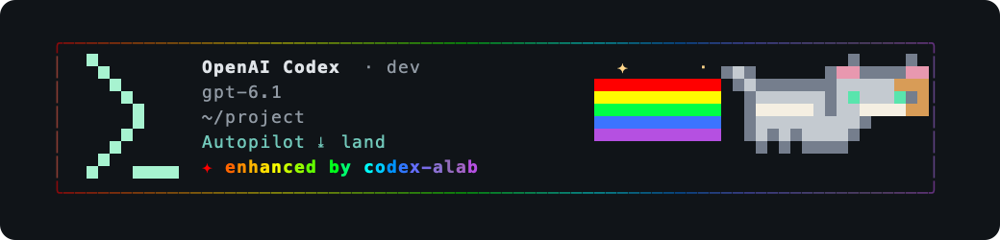

<!-- Copyright 2026 Andrew Yates; SPDX-License-Identifier: Apache-2.0 -->
# Codex opening banner

Owner direction, 2026-11-10: keep this terminal strip. The subsequent illustrated
redesign was cancelled before publication; no further visual redesign is requested.
The cancelled illustrator checkout is detached at an already published commit,
with clean source and ignored build evidence. Defer its removal under the clone’s
recorded human preservation direction; its task branch is deleted and no source
from that cancelled design is queued for publication.



The owner's reference is **aterm's decorated Claude Code harness strip**, whose renderer
lives in `aterm/crates/aterm-gui/src/claude_card.rs` and
`aterm/crates/aterm-effects/src/harness_card.rs`. The wrapper in `~/claude-code-alab`
does not own it. The visual reference inspected was
`aterm/docs/measured/card-engine-b3-2026-10-20/live-inline-scroll.png`: a strong vendor
mark at left, title and session facts beside it, a full-body cat riding a rainbow at
right, a rainbow ALab signature below, and a thin spectrum frame.

This design replaces the rejected stacked mint welcome panel. Codex gets a large mint
`>_` mark, OpenAI Codex identity, and a compact facts column. The full-body harness cat
is adapted from `KITTY_OPEN` at aterm `ac52db025e`, with a calico face, into terminal
half-blocks. One seven-row strip holds a typical model/directory/Autopilot session.
Extra facts, including permission warnings, add rows. There is no separate header,
welcome prose, help prompt or metadata compartment.

As width shrinks, art and then the large mark give way to facts; no layout wraps into
the final terminal column. Color honors terminal depth, light/dark backgrounds and
monochrome. The existing launch switch, reduced-motion, vanilla and explicit legacy-style
settings remain in force. Raw scrollback, copy and export retain the original header.

The PNG is the production renderer at 80 columns with sample model/directory facts,
rasterized from its styled spans; it does not claim to show the running session.

Preview without a model session:

```sh
cd codex-rs
targo --unverified run -p codex-alab-tui --example banner_preview -- 80
```

Validation: the production renderer compiled with Trust in an isolated Ratatui harness.
Checks cover widths 0–200, all four color depths, every harness word, light/dark backgrounds,
Unicode paths, permission text, and the compact reference layout. The targeted workspace
suite was attempted again; its V8 Chromium buildtools checkout is still missing, so it
cannot run offline. The previous network fetch stalled at chromium.googlesource.com.
The decision is to record that unavailable check and retain the dependency policy.
