<!-- Copyright 2026 Andrew Yates; SPDX-License-Identifier: Apache-2.0 -->
# Codex ALab launch card

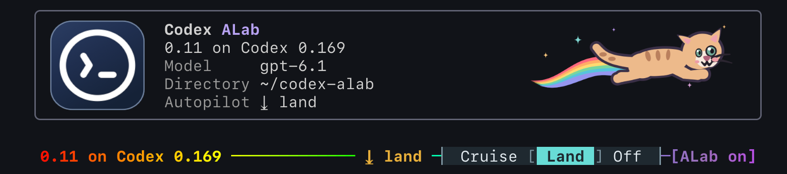

The enhanced interface puts the OpenAI Codex mark in the upper left, session
details beside it and ALab's flying rainbow kitty on the right. This arrangement
follows aterm's Claude Code harness card. The Codex mark uses the same vector
outline as upstream's welcome animation, on an ink-blue tile. The tabby and six
bands of color sit directly on the terminal background.

The title identifies the edition. The next line pairs the running ALab release
with its upstream baseline, for example `0.11 on Codex 0.169`. A package made
from a single published snapshot gets that number from its version ledger.
Its exact upstream source commit remains unknown. Reopening a saved
conversation creates a launch card for the executable opening it. The
rollout records the client version used to talk to OpenAI.

The illustrated card fits `0.11 on Codex 0.169` on one line at 20 columns,
with one cell free for terminal scrollback. At 13 and 14 columns it reads
`0.11 on` and `Codex 0.169` on two rows, keeping the upstream name beside
its version. The same grouping fits `Codex 0.169.1` from 14 columns.
The left margin grows back to
two spaces as the pane widens. With artwork disabled the same pair fits at
19 columns. Down to five columns the text header wraps the edition name
and release pair between words so both names and numbers remain readable.
A five-column header previously shortened `0.169.1` to `0.16…`.
It now wraps the number across two rows, `0.169` then `.1`. At six columns
the same rows read `0.169.` then `1`. Each piece starts at the left edge,
so the number can use the full width of the pane.

When an illustrated card shrinks below 13 columns, its text header keeps the
reported Autopilot mode. At 12 columns it reads `∞ cruise`, `⤓ land` or
`○ off`. If only the word fits, the header gives it the whole row. If even
the word is too wide, it uses the mode glyph. Widening the pane restores the
illustrated card with the current selection.

The Enhanced `/status` card uses the same grouping when its title wraps. From
19 through 32 columns, `0.11 on Codex 0.169` fits on one row beneath the
edition. At 33 columns the edition and release share one line. If a release
number is wider than the pane, the status card wraps its digits across lines.

Selecting `codex-version` in `/statusline` or `/title` shows the same release
pair in the Enhanced footer or terminal title. Each setup preview shows the
value that will appear there. Vanilla shows the running product version.

The session supplies the model, directory and any permissions details. Beside
the full-size Codex mark, a narrow row keeps its ten-cell caption whenever the
complete value fits. With `0.12 on Codex 0.169.1`, `GPT-6` and `YOLO mode`,
the Model, Access and Autopilot captions survive the 36-column icon and
40-column frame transitions. The full path `~/codex-alab` gains its Directory
caption one column later in each layout. Wrapped model settings keep the same
alignment when every line fits beside the caption.

The card drops the `Model` or `Directory` caption when doing so keeps the full
model and reasoning effort or the full checkout path visible. For a path longer
than its row, the card also gives up the caption if those ten cells recover
the entire checkout name. A name that fills the row appears on its own,
including any trailing path separator. When space permits, an ellipsis marks
omitted parent directories. When a model name and its settings fit on two rows, the card keeps them together in the same text column. At 69
columns the kitty appears beside `GPT-6.2-Astra`, with `· Ultrafast xhigh` on
the next row. At 74 columns the label fits on one line again. With an overlong custom deployment
name followed by `· Fast high`, the card uses the first row for the name's
identifying prefix and an ellipsis. The tier and effort get the second row.
In a 14-column pane the illustrated card can show all three parts of
`GPT-6.2-Astra · Ultrafast xhigh` by giving the model, tier and effort
one row each.
With the artwork off, the plain header uses the same word breaks and keeps
parentheses around the reasoning effort. At 28 columns,
`gpt-6.2-astra · Fast (xhigh)` fits on one row. The longer
`GPT-6.2-Astra · Ultrafast (xhigh)` takes two rows, with the tier and
effort together on the second. Its directory row likewise shows
`~/service-orchestration` in full at 23 columns. For a deeper path it keeps
the usual five-space indent and centered path if the checkout name is visible.
Otherwise it shows the complete checkout name when it fits, adding the leading
ellipsis and path separator as space permits. The illustrated card reads session
facts when its cached layout changes. Subsequent draws reuse those rows and
skip formatting the plain header. On known light backgrounds, the Model,
Directory, Access and Autopilot captions use a contrast-adjusted neutral in
RGB and 256-color terminals, or normal text intensity in 16-color and
monochrome terminals. On white in aterm, the four captions went from
4.00:1 contrast to 4.53:1 in truecolor and 16.10:1 in 16-color mode.
The plain header uses the same ink for the checkout path, reasoning effort
and `permissions:` caption. All three also measured 4.53:1 on white in
truecolor aterm, up from 4.00:1 with faint text.

On Windows, resuming or forking a session can create the card before the terminal
reports its background. Until then, the portable kitty face, fact captions,
bold `ALab` wordmark and `YOLO mode` warning use the terminal's configured
foreground with faint styling disabled. The rainbow keeps its six bands.
The open card adopts the reported palette once available. With `--no-alt-screen`,
a report received before the first scrollback write also
colors the queued card. It keeps the model and Autopilot mode shown at insertion.
Rows already written keep their original colors.

The illustrated `ALab` title and active `YOLO mode` permission indicator are
bold. With a reported background, RGB and 256-color terminals show them in
violet and magenta respectively.
In 16-color terminals both use the configured text color because palettes vary
in how they draw bold magenta. This gives both labels 11.41:1 contrast on
Andromeda, up from 3.13:1, and 16.10:1 on the white reference palette.
The enhanced plain header uses the same permission style when the artwork is
off. The warning stays bold even when the pane is too narrow for the `Access`
caption. The plain header also preserves
the full `YOLO mode` value from nine columns, with its usual emphasis.
It restores the `permissions:` caption at 22 columns and its full indent at
24. The Autopilot row shows the reported mode. The composer
below the conversation has the interactive **Cruise / Land / Off** switch.
Right-click or Control-click anywhere on the switch, including its borders
and dividers, to open the Autopilot picker. A primary click selects a mode
only within its labeled segment. The dividers sit between two possible
choices, so clicking one leaves the current mode and any timer in place.
Square brackets mark the reported mode at every color depth. Copying a compact
switch with Land selected yields `▏Cruise[Land]Off▕`. The brackets occupy its
two existing border cells. The selected fill, release pair and three click
targets keep their places.

When the Windows composer is drawn on the terminal's default background before
a palette report, the release pair, update hint and edition button use the
configured text color. The Autopilot status and its `▾` picker arrow use that
same foreground, including when the pane fits only one mode glyph. The picker
arrow, Cruise and active Land stay bold. Off uses normal weight. The rule keeps
its rainbow. In truecolor and 256-color terminals, the three named modes keep
their colored track. In 16-color terminals, the names and brackets use the
configured foreground and background, with the selected name bold and reversed.
An explicitly painted composer background selects its usual palette.

Before this change, 2,132 color configurations displayed identical switch text
across all three selections. In 446 of them only a neighboring glyph indicated
the mode in plain text. All 820 monochrome configurations already bracketed the
selected label. The compact Off setting can read `[Off][on]` beside the edition
button. Keeping this spacing preserves both controls in narrow panes. The other
two modes use normal terminal text. Dimming these actionable labels
measured 3.91:1 on a light aterm palette, below the renderer’s 4.5:1 target.

In these aterm captures of the native App test, the launch card names the
mode selected in the composer. Both display `0.11 on Codex 0.169` from the
sample package’s ALab release and upstream baseline. Its client version is
`0.170.0`.

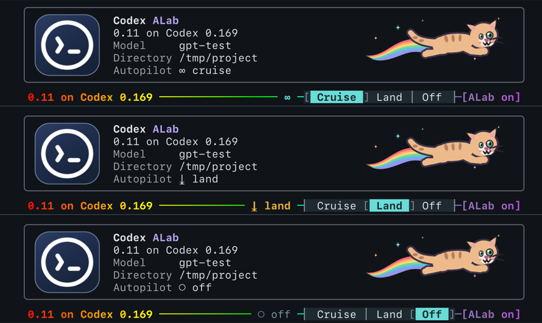

The glyph beside the switch distinguishes a Land task still running (`⤓`)
from one that has finished (`✓`). It stays visible as the pane widens, including
when `[on]` expands to `[ALab on]` or the three mode names gain padding.
In a direct macOS aterm pane, a one-cell clock (`◷`) beside the selected
Cruise label shows that a landing is scheduled. With `0.12 on Codex 0.169.1`
this fits at 48–60 columns. The full time fits at 61 columns, or at 70
when an update is pending. When all three names are hidden, the full status
shows `∞ cruise` so the current mode is legible. Smaller slots keep `∞`.
A primary click on the status selects Land immediately.
A secondary click opens the mode picker.

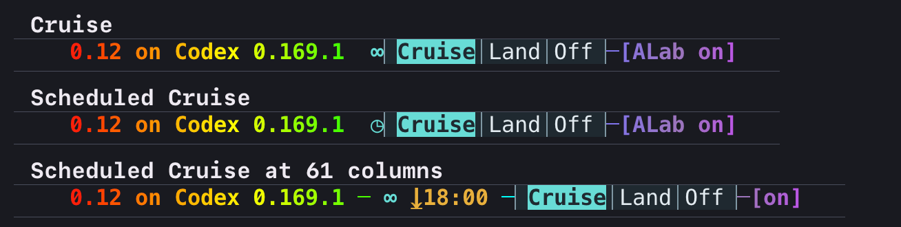

On light 16-color terminals the selected segment reverses the configured
foreground and background. The mode glyph beside it uses the terminal's
text color, with Cruise and Land in bold. The release pair, update hint and
edition switch also use the configured text color on these terminals. On
white in aterm, the faintest release text went from 1.12:1 contrast in bold
yellow to 16.10:1 in the terminal's text color. The rule between the controls
keeps its rainbow.
When a pane is too narrow for all three names, the current mode's glyph can
still open the picker on a secondary click. At 10 columns, the glyph sits
directly before `[on]`. At 11 columns, `▾` fits between them. When the short
release first appears at 15 columns, it uses one cell of the usual inset to
keep the picker available. `/alab menu` opens it from the keyboard. The empty `Cruise until…` field shows
`18:00 or +2h` so the local time and duration examples fit together at 16 columns.
At 16–26 columns the editor shows `enter submit` and `esc back` on two rows.
It borrows the blank row below the input so typing and resizing keep the same
cursor position. In Vim insert mode the Escape hint reads `esc normal mode`.
An invalid entry such as `25:00` or `+0m` stays in the editor for correction and preserves the last valid selection.

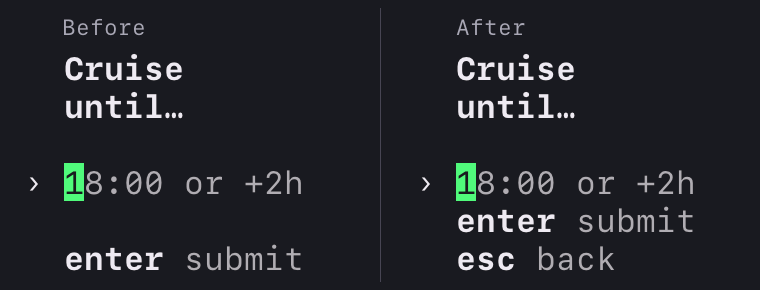

The compact layout gives the glyph and release numbers priority
over spelling out `ALab` on the presentation switch. A pending update can
also use space saved by tightening the three mode labels and shortening
`[ALab on]` to `[on]`. With the illustrated release, all three names and
`↑ update` fit from 59 columns while preserving the current mode glyph
where it was already visible. Before the supervisor reports a mode, the
hint fits from 39 columns. At eight columns,
`[off]` uses one cell of the left margin so the switch stays clickable
after turning the enhanced interface off.

A direct true-color aterm session renders both images through Kitty graphics.
Each grid cell addresses a tile of the image, so the pictures can scroll with
the header. Other terminals use a cell-drawn Codex mark, whiskered cat and
ribbon. On light 16-color terminals the cat uses the configured text color
so its eyes and whiskers stay visible beside the rainbow trail.
In a narrow window the card reserves room for the release pair and
session facts first. As the window widens it adds the Codex mark, then the frame,
then the kitty. Giving the frame its own four columns keeps the logo visible
through a resize. With the release shown here, the full-size logo fits at 34 columns
and the frame at 38. At 69 columns the kitty gets its own space beside the
first four rows. In a narrower frame it appears when those rows already leave
24 cells free on the right. If the full kitty cannot fit, the title and
release rows can still hold an 11×2 kitty with one spare cell on either
side. Direct truecolor aterm draws the PNG. In tmux and reduced-color terminals, six
rising blocks form a rainbow trail behind the cat's ears and face. The same
silhouette is visible in plain text. With `0.12 on Codex 0.169.1` and
`~/codex-alab`, the smaller cat fits at 53–64 columns and the full-size cat
at 65. The facts and frame keep the same positions. The two native sizes
have separate image IDs, and the smaller one uses two 96-scanline strips
in scrollback. Rows below the illustration use the full text width. When a
long model wraps at 69 columns, this gives the directory below it 50 cells
for its caption and path. With a short model, the card can put
Access beside the kitty and Directory directly below when the wider row
recovers the directory caption, full path, or checkout name. The complete
permission must still fit beside the artwork. At 73 columns the card shows
the full path `~/projects/production/codex-native-release-s0.noindex`.
At 82 columns its Directory caption fits below the kitty. At 96 columns the
path alone fits beside the kitty, so the card keeps it below with its caption.
At 106 columns the caption and path fit together beside the kitty and
Directory returns above Access. The card stays eight rows high.
A logo-only pane uploads 34,827 bytes
of Kitty graphics packets. Deferring the kitty until it appears saves 42,837
bytes on that first frame. If aterm's image store resets, the next draw
registers the images visible in the restored buffer.

In a narrow pane the upper-left Codex mark uses six cells by three rows.
Direct truecolor aterm draws the original PNG. Monochrome, reduced-color and
multiplexed sessions draw the ring in Braille with the same `❯_` strokes as
the larger text icon. The text mark uses the terminal’s configured foreground.
The card measures the finished text before choosing the smaller mark, so the
version and each session fact stay on their original line. With
`0.12 on Codex 0.169.1` and the directory below, the compact mark fits at
31–35 columns. Both PNG sizes have their own terminal image ID. The compact mark’s
three history strips retain all 160 source scanlines when the card scrolls away.

When the details need the full line, direct truecolor aterm can still draw the
Codex mark beside just the title and release. The same square PNG occupies
four columns and two rows. The mark leaves two cells before the text when
they fit, and one when that keeps the complete release on its row. At 31 columns,
this keeps the logo visible as the Directory caption appears for
`~/projects/東京/猫`. Each detail retains its original left margin, and the
two history strips preserve all 160 scanlines. Text terminals keep the
six-column ring where it fits. At four columns its prompt strokes were
indistinct in Menlo and Monaco, and fitting a six-column ring beside the model
alone moved its caption away from the other session facts.

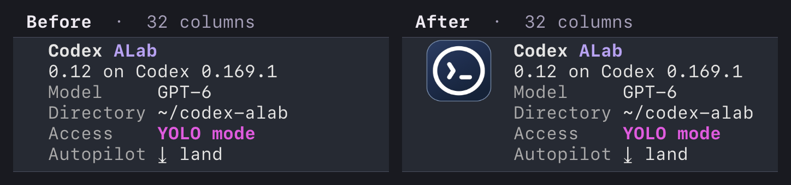

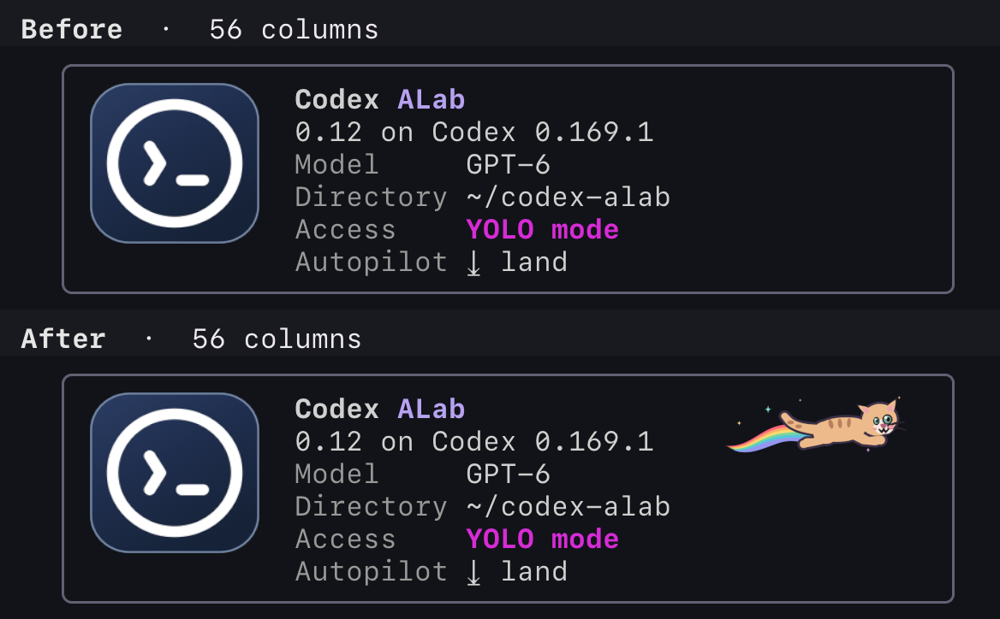

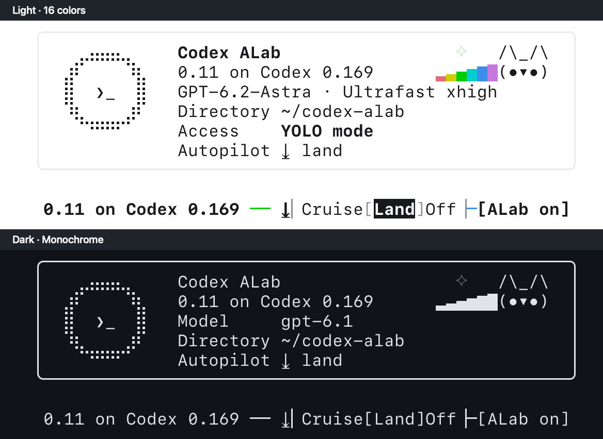

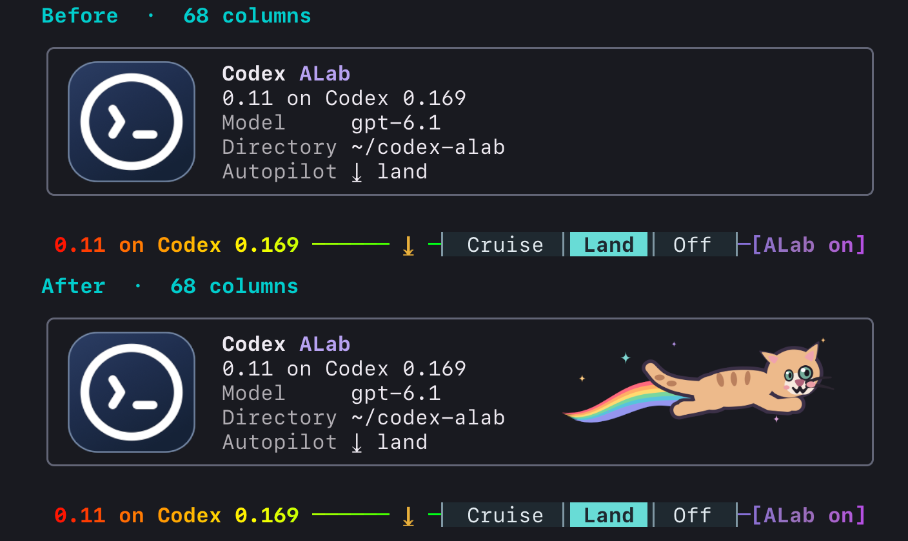

The card measures text one grapheme at a time using Ratatui's cell widths.
This keeps the right border on the same row for Arabic checkout names and
halfwidth Japanese text, and keeps joined emoji intact when a name is clipped.

When the illustrated header moves into native terminal history, aterm keeps
each image row with its line of text. The build takes lossless, full-width
strips from the two original PNGs so the writer sends just the pixels in
that row. At 80 columns the nine Kitty transfers total 67,024 bytes, down
from 345,438 when each transfer contained a complete image. The archived
strips need no image ID and survive replacement of the live banner. Raw
scrollback and exports use the session header's text.

Selecting just the version in the Codex transcript copies `0.11 on Codex 0.169`.
In a whole-row selection, each column occupied by a native image copies
as one space. Text artwork copies as its visible characters. Selecting
across an edge of a native image preserves the visible text's alignment.
User messages retain their original Unicode text, including private-use
characters and combining marks.

aterm's own terminal selection reads the live grid. In aterm 0.208.0
(build `376345c209b6`), copying the entire 80-column release row also copies
32 Kitty image markers and their coordinates (256 bytes). In a tested source
build of aterm 0.209.0, those 32 columns copied as spaces and the release
text stayed intact. The host recorded which cells were image tiles when the
row entered scrollback. Reusing the live image ID preserved the archived
selection.

Codex's native-history writer preserved every pixel of the logo and kitty
when the 80-column card was scrolled back into view after image ID reuse.
Scrolling raw Kitty placeholder characters into aterm's history can leave
their coordinate accents visible in place of both pictures.

The design reference is aterm's
`docs/measured/card-engine-b3-2026-10-20/live-inline-scroll.png`.
The wrapper in `claude-code-alab` delegates that card to aterm's
`crates/aterm-gui/src/claude_card.rs` and
`crates/aterm-effects/src/harness_card.rs`.

## Scheduled Cruise in the opening card

At 28 columns a supervised Cruise with a landing scheduled for the same day
can read `Autopilot ∞ cruise ⤓18:00`. At 24 columns a next-day landing can
read `∞ cruise ⤓Fri 06:00`. The card first places its ordinary Cruise row,
captions, Codex mark and rainbow kitty. It adds the complete deadline in the
remaining space. A tighter row keeps `∞ cruise`.

The card reads the local deadline reported by aterm. Changing or clearing
the timer refreshes the displayed card. An idle screen schedules a local
midnight redraw, including during a server disconnect, so the weekday drops
off when the scheduled day begins. A restored session reads its current
host.

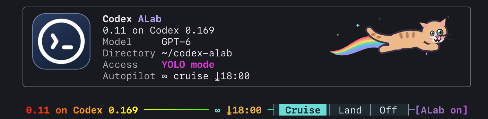

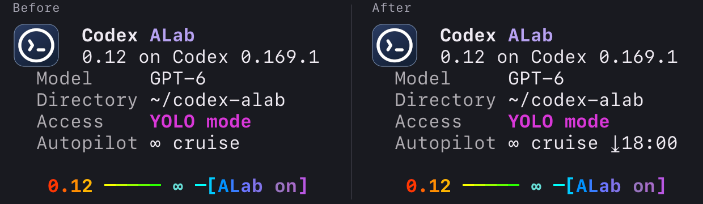

The composer keeps the landing visible after the opening card scrolls away.
A Cruise scheduled for another local day shows `∞ ⤓Fri 06:00`. At midnight
it becomes `∞ ⤓06:00`. With `0.11 on Codex 0.169`, widening from 64 to 65
columns used to drop Friday as the mode buttons gained padding. The edition
button expanded at 70 columns and dropped Friday again.

With 13 cells between the release and named switch, `∞⤓Fri 06:00` leaves
a blank cell on each side. A fourteenth cell separates the two glyphs.
The switch keeps its three click targets and the edition button keeps its
place. The whole clock selects Land on a primary click and opens the
Autopilot picker on a secondary click. Shorter layouts show the time or the
compact clock glyph. The wider example shows the full edition label beside
the switch. [80-column composer](assets/codex-composer-weekday.png)

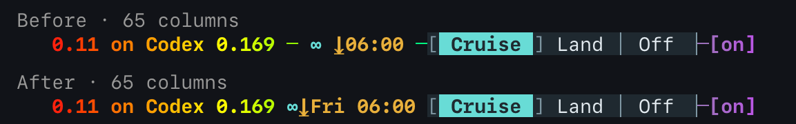

When the named switch collapses, a small `▾` beside the status opens the
native Cruise, Land and Off picker. At 28 columns the controls read
`∞▾─[ALab on]`. Clicking `∞` still selects Land. Clicking `▾` opens the
choices with the current mode selected. Escape returns to the draft, and a
choice such as Off goes straight to that mode. Where a separator fits before the
edition button, it stays outside both hit targets. With the sample release
pair, the arrow stays available from 11 through 45 columns. At 46 columns
the three named modes take its place. Full-screen sessions capture mouse clicks by default.
In native scrollback mode, use `/alab menu` when the terminal owns the mouse.

The picker has one Autopilot heading. Its subtitle begins with the current
mode, so it stays visible while scrolling to the timers. At 14 columns that
leaves another row for choices. The spoken `/alab autopilot` command gives
the full status, including the control name.

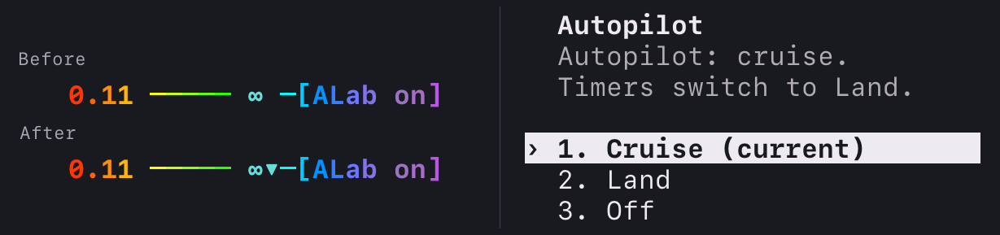

In an 11-column picker, wrapping `(current)` used to take two rows below
Cruise. A checkmark in the number gutter now keeps each mode on one row.
The check stays beside the mode aterm reports as the focus arrow moves.
The full marker fits again at 21 columns for Cruise, 19 for Land and 18 for Off.

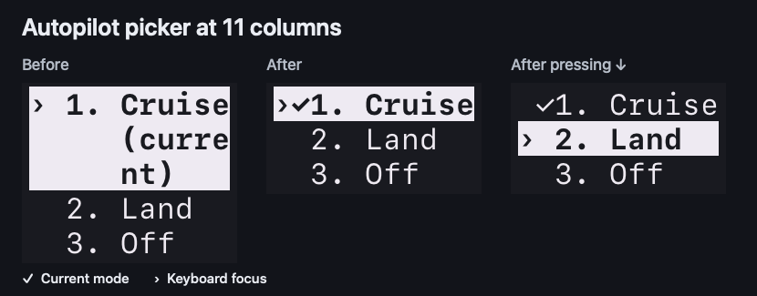

On the full-screen composer, pointer hover uses the same underline as the
picker. Only the pointed-at name gains the underline. The brackets still
identify the active mode.

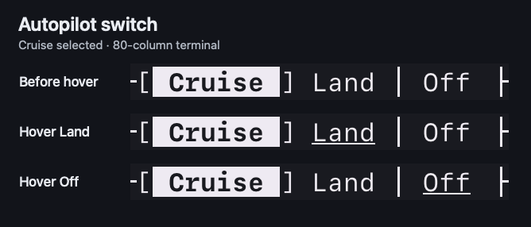

A saved `/alab menu` preset opens the picker immediately while idle and
preserves a multiline draft and its caret. During an active turn, the same
preset waits in the prompt queue until the turn finishes. Enhanced therefore
offers **Open Autopilot picker** in the native `/keymap` editor. The action opens
the same three-way picker directly during a turn. After you bind it, the
Session group in the `?` shortcut reference shows the key or chord beside
`Open Autopilot`. It starts unbound so existing
terminal and editor bindings keep their meaning. Escape restores the draft at
its original caret position, and queued follow-ups keep their order. The picker guards against a held
chord terminator selecting a numbered mode. Terminals that report key releases
can distinguish the next press. Press-only terminals use the native repeat window.

## Preview

The opening image shows the card at 80 columns on a dark background. At 69
columns on white, the kitty fits beside the model and its settings. The
composer keeps all three modes visible with Land selected.

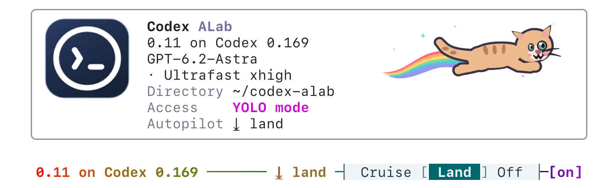

Both images are cropped 2× captures from headless aterm. The preview example
renders the launch card and the composer's top row with sample release and
session data. Below 13 columns the sample shows the plain edition, release
and mode rows. At five columns both versions are still readable in full. It uses the
terminal's available color depth. With `WT_SESSION` set, the preview supports
Windows Terminal truecolor unless the environment overrides it. On native
Windows, the default sample uses the terminal's configured text color for the
card captions and composer labels. The `light` sample supplies a known white
background. In aterm, scrolling back preserves the Codex mark and kitty. Selecting the
release line copies the version text and its spacing.
Run the preview from `codex-rs` with no arguments to fit the terminal receiving
its output. Piped output defaults to 80 columns, as does a terminal whose size
is unavailable. Piped output and `NO_COLOR` use plain text. Use `light` on
its own for the white reference palette and its sample model and permissions
at the current width. Pass a width before `light` to reproduce a particular layout.
The sample starts with Land selected. Pass `--mode cruise`, `--mode land`, or
`--mode off` to see that state in both the opening card and the switch.
`--help` lists the available arguments.

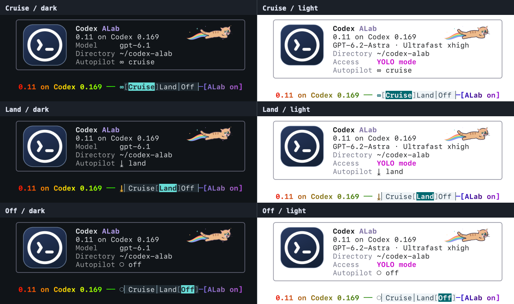

```sh
targo --unverified run -p codex-alab-tui --example banner_preview
targo --unverified run -p codex-alab-tui --example banner_preview -- light
targo --unverified run -p codex-alab-tui --example banner_preview -- 80
targo --unverified run -p codex-alab-tui --example banner_preview -- 69 light
targo --unverified run -p codex-alab-tui --example banner_preview -- 69 light --mode off
```

After building the example, run its smoke test from `codex-rs`.

```sh
python3 ../alab/smoke/banner_preview.py target/debug/examples/banner_preview
```

Pass the path to your built executable if you use a different target directory.
On Windows, include the `.exe` extension. The test checks the release pair
and selected mode in piped output for both palettes, the 80-column Land
default, command help and invalid mode arguments.

On macOS or Linux, run the native graphics check from `codex-rs` with the
ordinary example build. Its JSON output identifies the preview executable
and the PNG rows embedded in that build.

```sh
targo --unverified build -p codex-alab-tui --example banner_preview --message-format=json | python3 ../alab/smoke/banner_preview_graphics.py
```

The check captures the preview in a pseudoterminal configured as aterm. It
checks that the Codex mark appears to the left of the title and the rainbow
kitty to the right, using the compact and full-size artwork on both light
and dark backgrounds. At 28 columns it checks that the title keeps its Codex
mark. It also checks text fallbacks with `NO_COLOR` and with tmux terminal
settings.

With the preview's `0.11 on Codex 0.169` release, both samples first fit
the 11×2-cell kitty at 51 columns. The shorter dark sample fits the
22×4-cell kitty at 65 columns. The light sample uses the space for its
longer model settings until 69 columns. The smoke check measures each
image strip against the card's right border, including in a 120-column
pane where the card stops short of the terminal edge.

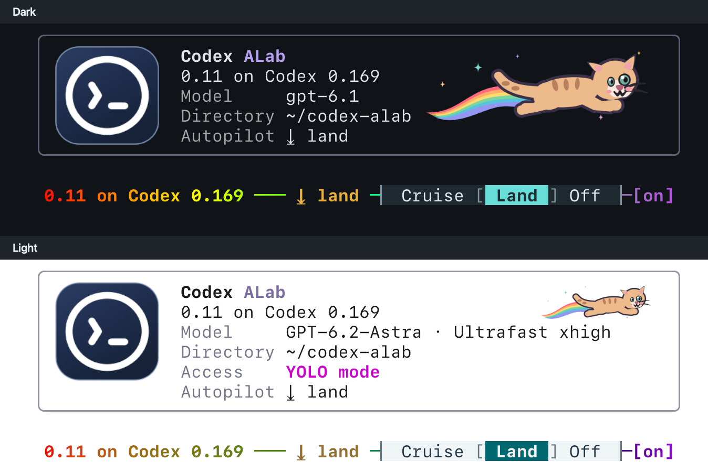

For the preview's `0.11 on Codex 0.169` samples, the check also verifies
the upper-left mark as the pane widens. At 24 columns both samples give
the whole row to text. At 25 columns the four-cell title mark fits with
a one-cell gap. At 26 columns the usual two-cell gap returns.
From 31 through 33 columns the dark sample fits the six-cell mark, while
the longer model in the light sample keeps the four-cell mark. At 34
columns both fit the ten-cell mark. Each frame keeps the release pair
together under the title.
The check verifies that the strips line up at the same left edge and that
the title and release leave the terminal's last column free.

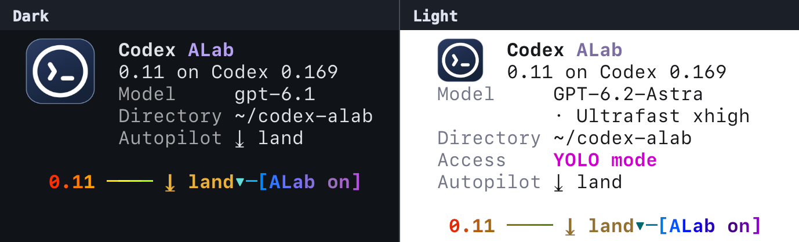

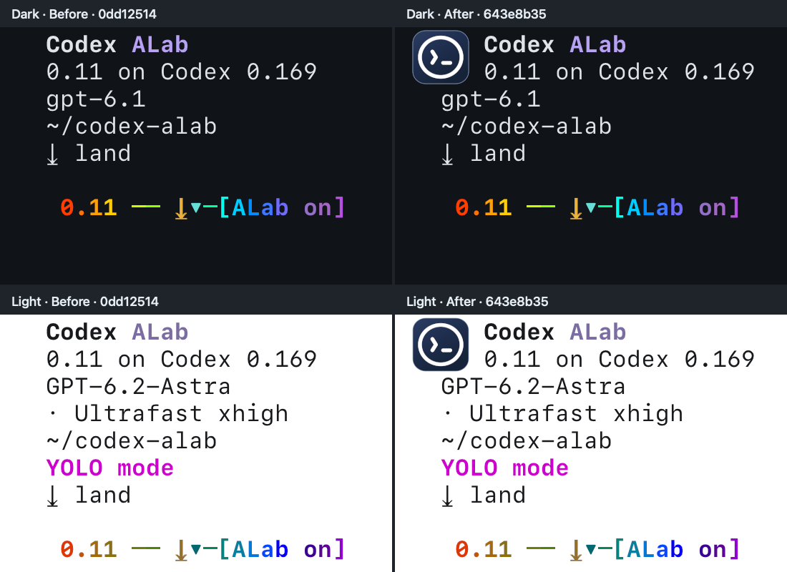
